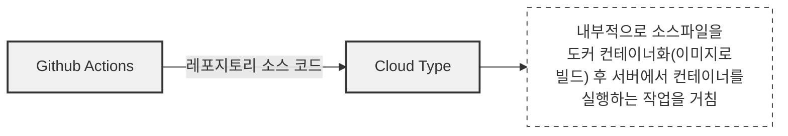

## 📓 프로젝트명
- 식품 정보공유 사이트: <mark><b>Food Picker</b></mark>
- <변경 전: ~ 2024.05.24 >


- <변경 후: 2024.05.24 ~ >


## 🎫 프로젝트 목적
- 우리 지역의 음식, 다양한 음식의 영양정보, 간단한 레시피 등 음식과 관련한 다양한 정보를 쉽게 찾아서 활용할 수 있으면 좋지 않을까 라는 생각에 개발하게 되었습니다.


## 📅 개발기간
- (1차 개발) 2023년 7월 16일 ~ 2023년 8월 13일
- (2차 개발) 2024년 5월 24일 ~ 2024년 6월 12일
- (유지보수) 2024년 6월 13일 ~

## 🔥 배포
- 24.06.12 기준으로 백엔드는 NodeJS + TS + Express 환경에서 Github Actions + CloudType 플랫폼 기반으로 배포가 진행되었습니다(배포과정: https://duklook.tistory.com/554).

- 루트 도메인: https://foodpick.co.kr/
- 서브 도메인: https://www.foodpick.co.kr/
- 배포 아키텍처



## 🧰 프레임워크 / 라이브러리 / 그 외 도구
### 프론트엔드/백엔드

|      사용 스텍       | 선택 이유  |
| :------------------ | :---------------------- |
|    Typeccript(^5.4.2)    | (언어) 정적 타입 검사를 통한 타입 안정성 확보 위함   |
|     ReactJS(^18.3.1)     | (SPA) 개인적으로 SPA 프레임워크(혹은 라이브러리) 중 VueJS 보다 더 유연하고, 기능 확장이 유연한 점이 편했기에 선택 |
| SASS(^1.77.2)  | (CSS 프레임워크) CSS 코드 재사용성 향상 및 상속 구조 단순화 |
|   Recoil(^0.7.7)    | (전역 상태관리) 단순한 상태의 전역 관리. Redux Toolkit 과 Zustand 와 비교했을 때, 상태 및 상태설정을 단일 컴포넌트 내에서 매우 쉽게 관리 할 수 있다는 이점이 돋보여서  선택 |
|     @tanstack/react-query(^5.39.0)      | (서버 상태관리) Redux Toolkit을 활용한 서버 상태 관리의 복잡성(비동기적 입출력을 처리하기 위해 미들웨어 적용 시 코드가 지저분해 지는 것 등) 개선 및 무한 스크롤 기능 적용 시 캐싱 기능의 이점을 최대화 하기 위해 선택 |
|    gsap(^3.12.3)     | (애니메이션) icon 드래그 어블 애니메이션 적용 및 이외 복잡한 스크롤 기반 애니메이션 적용 시 필요|
|    express(^4.18.3)     | (백엔드) 보다 더 가볍고, 확장성이 높다고 알려진 fastify 선택을 고민했으나, 미들웨어 처리의 유연성이 독보적이고, 보다 문서화가 잘 되어 있어서 선택|

### 데이터베이스
|      사용 스텍       | 선택 이유  |
| :------------------ | :---------------------- |
|    SQLite(^5.11.0)    | 복잡한 관계없이 대량의 데이터를 조회하고 빠른 쿼리를 생각한다면 NoSQL이 최적이겠으나, 개인적으로 관계형 데이터베이스의 학습 목적 및 별도의 서버없이 데이터베이스 구축과 적용이 가능하다는 이점, 향후 타 RDBS 이전 시 용이성이 돋보여서 선택 |


## 🗂️ 프로젝트 구조[백엔드]
```
📦src
 ┣ 📂bin
 ┃ ┗ 📜www.ts -------------------------> 포트 연결
 ┣ 📂controllers ----------------------> 컨트롤러
 ┃ ┣ 📜localfood.controller.ts
 ┃ ┣ 📜localmarket.controller.ts
 ┃ ┣ 📜naver.controller.ts
 ┃ ┣ 📜nutrition.controller.ts
 ┃ ┗ 📜traditionalfood.controller.ts
 ┣ 📂models ---------------------------> 모델
 ┃ ┣ 📜localfood.model.ts
 ┃ ┣ 📜localmarket.model.ts
 ┃ ┣ 📜naver.model.ts
 ┃ ┣ 📜nutrition.model.ts
 ┃ ┗ 📜traditionalfood.model.ts
 ┣ 📂db  ------------------------------> 데이터베이스 연결
 ┃ ┗ 📜dbConnection.ts
 ┣ 📂routes ---------------------------> 라우터
 ┃ ┣ 📜localfood.router.ts
 ┃ ┣ 📜localmarket.router.ts
 ┃ ┣ 📜naver.router.ts
 ┃ ┣ 📜nutrtion.router.ts
 ┃ ┗ 📜traditionalfood.router.ts
 ┣ 📂utils ---------------------------> 유틸 함수
 ┃ ┗ 📜helper.ts
 ┣ 📜Inversify.config.ts -------------> 의존성 주입 구성
 ┗ 📜server.ts 
```
